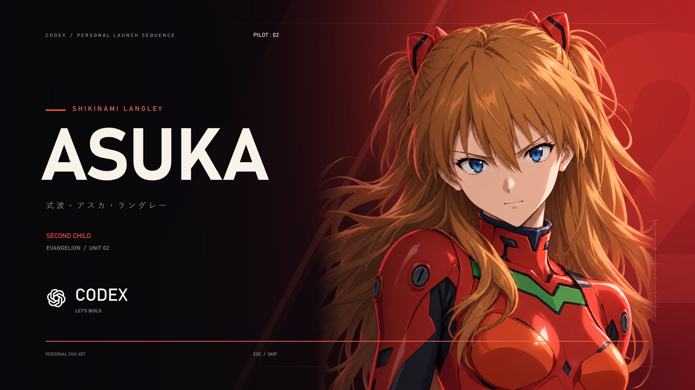

# アスカ × Codex 起動アニメーション

[English](README.md) | [简体中文](README.zh-CN.md) | **日本語**

Codex のウィンドウ上に約 5 秒間のアスカのアニメーションを表示してから、Codex を前面に表示する Windows 向けのファン製ランチャーです。



## 動作環境

- Codex デスクトップアプリがインストールされた 64 ビット版 Windows。
- `AsukaCodex.exe` と `assets` フォルダーを同じ場所に置いてください。ランチャーはインストール済み Codex の Windows アクティベーション識別子を使用します。

## 使い方

GitHub からリポジトリを ZIP 形式でダウンロードして展開し、`AsukaCodex.exe` をダブルクリックします。Codex が開いていない場合は、先に起動してウィンドウの表示を待ちます。アニメーションはウィンドウの位置とサイズに追従し、縦長・横長に応じてレイアウトが変わります。

- **Esc**：アニメーションをスキップして Codex に進みます。
- **Alt+F4**：アニメーションを閉じます。コールドスタート時に Codex がすでに起動している場合、Codex は終了しません。
- Windows のログインセッションごとに表示されるアニメーションは 1 つです。画像素材を読み込めない場合は Codex を直接開き、音声を再生できない場合は無音で続行します。

PowerShell で `install-shortcuts.ps1` を実行すると、デスクトップにショートカットを作成できます。プロジェクトを移動した場合は、このプロジェクトが作成した古い 2 つのショートカットを削除してから再実行してください。同名の無関係なショートカットは上書きしません。

## プレビューとビルド

Codex を開いた状態で実行します。

```powershell
.\AsukaCodex.exe --preview
.\AsukaCodex.exe --preview --hold
```

1 つ目は Codex をアクティブにせず再生します。2 つ目は無音で最終フレームを表示し続けます。Esc または Alt+F4 で終了します。

Windows の .NET Framework コンパイラでビルドし、素材を確認します。

```powershell
.\build.ps1
.\AsukaCodex.exe --frames
.\tests\verify-assets.ps1
.\build\WindowTargetTests.exe
```

`build.ps1` はアプリのアクティベーションテストも実行するため、Codex が起動・アクティブになることがあり、通常のデスクトップ権限が必要な場合があります。.NET SDK は不要です。`AsukaCodex.exe --frames` はフレームを `previews/` に出力し、`--preview --measure` は WPF の描画コールバック間隔とウィンドウの境界を同フォルダーに記録します。コールバック間隔は GPU の実フレームレートではありません。

## 補足

これは個人による非公式のファンプロジェクトであり、OpenAI とは関係ありません。目の動きは 3 種類の状態とその遷移で表現しており、キャラクター全体のフレーム単位のアニメーションではありません。インストール済みの Codex は変更しません。記録された受け入れテストでは、完全終了後のコールドスタートと、DPI の異なるモニター間での移動は実機確認していません。

## 免責事項

本プロジェクトは非公式のファン作品であり、作中に登場するキャラクター、名称、標章の権利者による公認を受けたものではなく、権利者との提携関係もありません。それらの権利は各権利者に帰属します。本プロジェクトは現状のまま無保証で提供されます。利用、改変、再配布に必要な許諾は、利用者自身で確認してください。このリポジトリにはまだオープンソースライセンスが指定されていません。
